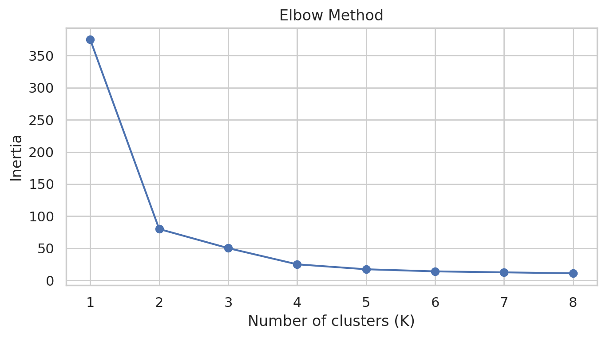
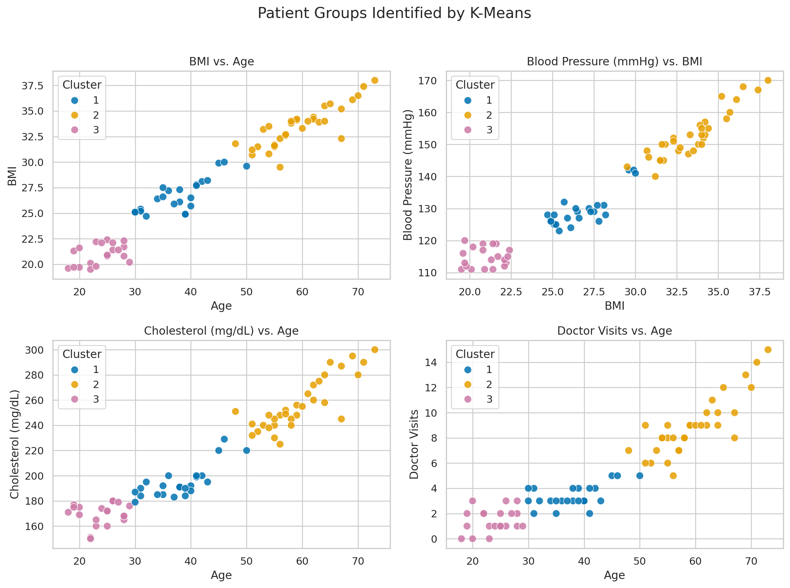

# Patient Profile Clustering with Python

An academic analysis by Mei Qiong Xue using K-means to explore 75 patient records across age, BMI, blood pressure, cholesterol, and annual doctor visits.

## Method
- Excluded Patient ID and checked the five features for missing or nonnumeric values.
- Standardized measurements with StandardScaler before fitting K-means.
- Compared inertia for K = 1–8 and explored three patient profiles using K = 3, random_state = 42, and n_init = 10.
- Summarized cluster averages in original measurement units and visualized relationships.

The elbow plot does not conclusively establish K = 3 as optimal. Three clusters are an exploratory modeling choice, not validated clinical risk categories.

## Results
| Cluster | Patients | Mean age | Mean BMI | Mean blood pressure (mmHg) | Mean cholesterol (mg/dL) | Mean annual visits |
|---|---:|---:|---:|---:|---:|---:|
| 1 | 23 | 37.96 | 26.77 | 129.52 | 194.74 | 3.39 |
| 2 | 32 | 59.56 | 33.48 | 152.91 | 256.72 | 8.94 |
| 3 | 20 | 23.85 | 20.98 | 114.85 | 169.35 | 1.45 |

Cluster 3 could inform routine preventive services, Cluster 1 could support early preventive outreach, and Cluster 2 could be prioritized for further assessment and care coordination. These profiles may help tailor services and allocate resources, while individual care decisions require clinical assessment.

## Charts



## Run the analysis
Use Python 3 and install the dependencies:
```bash
python -m pip install -r requirements.txt
python Patient_Profile_Clustering.py
```
Place the course workbook `Class 5 - Dataset.xlsx` beside the script, with the worksheet named `Raw Data`. The source workbook is not included in this repository. Required columns are `Patient ID`, `Age`, `BMI`, `Blood Pressure (mmHg)`, `Cholesterol (mg/dL)`, and `Doctor Visits`.

The script prints cluster assignments and saves both charts and `patient_cluster_summary.csv`.

## Report and validation
[Read the report](Patient_Profile_Clustering_Report.docx).

The script was run against the supplied course workbook. The 75 complete records reproduced the reported cluster sizes and averages to two decimal places. Results describe this small dataset; they do not establish causation, optimal treatment schedules, or validated patient risk scores. Future work could compare silhouette scores, clustering stability, and results on independent data.
